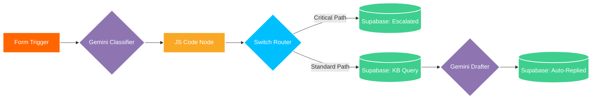
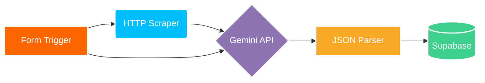
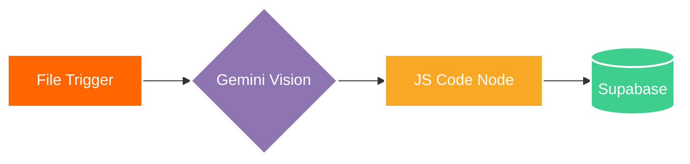
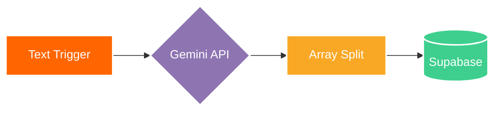

# AI Automation Learning Journal

Personal repository documenting my hands-on practice with backend workflow automation, API integrations, and LLM-driven data processing. 

Focusing on practical architecture: moving raw inputs through programmatic checks, passing structured payloads to AI models, routing contextually, and logging clean results into relational databases.

## Core Technical Concepts Explored
- **Multi-Path Conditional Routing:** Splitting workflow execution dynamically based on LLM-extracted urgency metadata (`Critical` vs. `Standard`).
- **Lightweight RAG Pattern:** Contextually retrieving reference documentation from Supabase relational tables to ground AI email generation in accurate domain knowledge.
- **Human-in-the-Loop Safeguards:** Automatically halting LLM customer-facing responses for high-risk tickets while persisting audit logs for human agent escalation.
- **Payload Normalization:** Cleaning raw LLM strings, stripping markdown fences, and merging trigger payloads with AI metadata using custom ES6 JavaScript.

## Practiced Workflows

### 1. Automated Support Ticket Classifier & RAG Engine
- **Overview:** Ingests customer support submissions, classifies issue intent and urgency via Gemini Flash, routes critical issues for manual review, and drafts KB-grounded auto-replies for standard inquiries.
- **Data Flow:** Form Trigger $\rightarrow$ Gemini Flash (Classifier) $\rightarrow$ JS Data Sanitizer $\rightarrow$ Switch Router $\rightarrow$ [Branch 0: Direct Escalation to Supabase] OR [Branch 1: Supabase KB Query $\rightarrow$ Gemini Flash (Drafter) $\rightarrow$ Supabase Audit Log].

### 2. Lead Qualification and Enrichment Pipeline
- **Overview:** Evaluates inbound form data and enriches it with real-time website context.
- **Data Flow:** Web Form Trigger $\rightarrow$ HTTP Request (Website Scraper) $\rightarrow$ Gemini Flash (Scoring & Drafting) $\rightarrow$ Custom JSON Parser $\rightarrow$ Supabase PostgreSQL.

### 3. Document and Receipt Extraction Engine
- **Overview:** Uses multimodal vision capabilities to parse unstructured receipt and invoice images into structured accounting schemas.
- **Data Flow:** File Upload Trigger $\rightarrow$ Gemini Vision API $\rightarrow$ Sanitization Code Node $\rightarrow$ Supabase Database.

### 4. Transcript Action Item Extractor
- **Overview:** Converts a single paragraph of meeting notes into multiple discrete, assigned task records.
- **Data Flow:** Text Input Trigger $\rightarrow$ Gemini Array Generator $\rightarrow$ JavaScript Array Iterator $\rightarrow$ Supabase Tasks Table.

## Tools & Tech Stack
- **Automation Engine:** n8n Workflow Automation
- **AI Integration:** Google Gemini API (`gemini-1.5-flash`) via Google AI Studio
- **Data Layer:** Supabase / PostgreSQL
- **Data Processing:** JavaScript (ES6)
- **Version Control:** Git / GitHub
