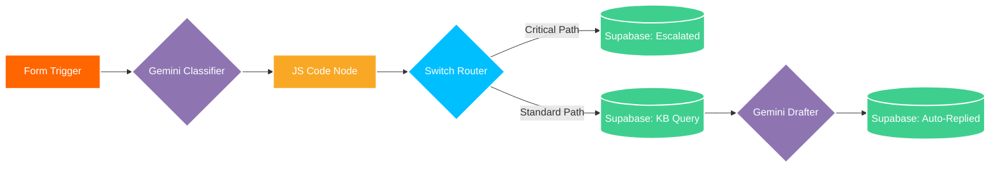

# Automated Support Ticket Classifier & RAG Engine

An automated support ticket classification, routing, and auto-response pipeline built using **n8n**, **Google Gemini**, and **Supabase**.

## Core Concepts Learned & Practiced
- **Zero-Shot LLM Classification:** Enforcing strict JSON schemas on Gemini (`gemini-1.5-flash`) to extract `category`, `urgency`, and `summary` metadata from unstructured ticket text.
- **Custom Payload Normalization:** Using an ES6 JavaScript Code node to strip markdown code blocks from LLM responses, handle parse errors with fallbacks, and merge original trigger inputs with AI metadata.
- **Multi-Path Routing & Safeguards:** Routing incoming traffic through a Switch node—halting automated replies for high-risk critical tickets (`Needs Human Review`) while automatically processing standard inquiries.
- **Lightweight RAG (Retrieval-Augmented Generation):** Dynamically querying a Supabase knowledge base table based on ticket category to ground AI email draft generation in domain knowledge.
- **Audit Persistence:** Storing complete execution histories, classification tags, ticket statuses, and generated replies in a Supabase PostgreSQL database.

## Workflow Architecture & Data Flow

## Tools & Tech Stack
- **Automation Engine:** n8n Workflow Automation
- **AI Model:** Google Gemini API (`gemini-1.5-flash`)
- **Database:** Supabase / PostgreSQL
- **Scripting:** JavaScript (ES6)
